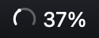
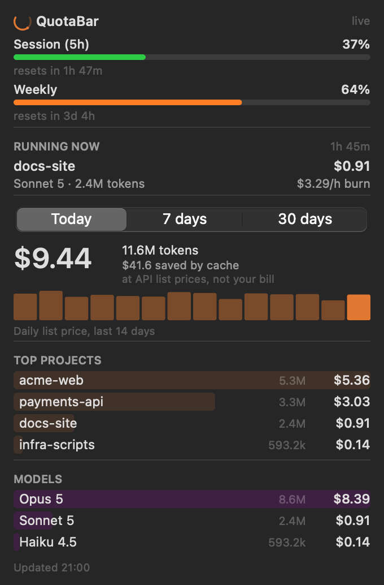
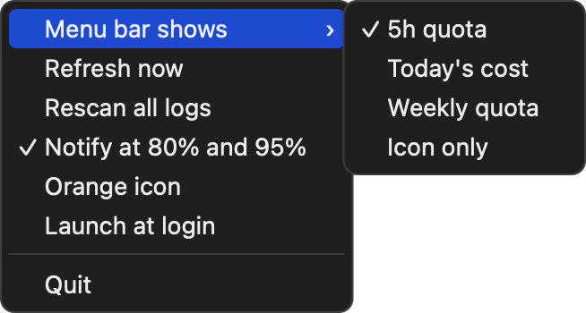

# QuotaBar

[](https://github.com/Gr0mar/quotabar/actions/workflows/tests.yml)
[](LICENSE)


A macOS menu bar tracker for Claude Code: how much of your subscription window is left, when it will run out, and what your usage would cost at API list prices. The dial fills as the quota goes, so the shape alone tells you where you stand; click it for the full report.





## Install

Download the latest zip from [Releases](https://github.com/Gr0mar/quotabar/releases), unzip it, drag `QuotaBar.app` into `/Applications`, then run once:

```bash
xattr -dr com.apple.quarantine /Applications/QuotaBar.app
```

Without that macOS 15+ refuses the first launch (*"QuotaBar" Not Opened — Apple could not verify…*). **Click Done, not Move to Bin**, then run the command — or press **Open Anyway** under System Settings → Privacy & Security. The app is ad-hoc signed, not notarised; notarising needs a paid Apple Developer account, and if this project earns one the step disappears.

macOS will ask once for keychain access — that is the single OAuth read described in [docs/internals.md](docs/internals.md). Deny it and everything still works from the statusline file or a local token count.

Requirements: macOS 13+, Claude Code with at least one logged session, and the system `/usr/bin/python3` with the Xcode Command Line Tools (`xcode-select --install`).

From source:

```bash
git clone https://github.com/Gr0mar/quotabar.git && cd quotabar
./scripts/setup.sh          # venv, tests, and a bundle in /Applications
```

## What it shows

| Section | What it answers |
|---|---|
| Session (5h) / Weekly | How much of the subscription quota is used, when it resets, and — once the burn rate is measurable — when it will run out |
| Running now | The session writing to a log right now: project, model, cost, burn rate per hour |
| Today / 7 days / 30 days | Cost and tokens for the window, with a 14-day daily-cost sparkline |
| Top projects | Which repos the spend went to |
| Models | Opus / Sonnet / Haiku split, and what prompt caching saved |



The label shows the 5h quota by default; the menu switches it to the weekly quota, today's cost, or the icon alone, turns the 80% / 95% notifications off, colours the icon orange instead of letting macOS tint it, and adds the app to your login items.

Every dollar figure is the **API list price** of the tokens used, not a bill: on a subscription you pay a flat fee, so read it as "what this usage would cost pay-as-you-go".

## How it works

Spend comes from the session logs Claude Code already writes under `~/.claude/projects/`; the quota windows come from Anthropic's usage endpoint (one keychain read, no redirects, nothing stored) or from the optional statusline hook. Nothing else leaves your machine. The details — de-duplication of log lines, how the run-out time is projected, the statusline hook, idle cost — are in [docs/internals.md](docs/internals.md).

## Uninstall

```bash
rm -rf /Applications/QuotaBar.app
rm -rf ~/Library/Application\ Support/QuotaBar
rm -rf ~/Library/Caches/com.github.gr0mar.QuotaBar
launchctl bootout gui/$(id -u)/com.github.gr0mar.QuotaBar 2>/dev/null
rm -f ~/Library/LaunchAgents/com.github.gr0mar.QuotaBar.plist
defaults delete com.github.gr0mar.QuotaBar 2>/dev/null
rm -rf ~/.claude/usage-bar
```

## Development

`./scripts/setup.sh` builds the venv, runs the tests and installs a bundle; `.venv/bin/python -m unittest discover -s tests` runs the tests alone (no network, no display, no keychain). Scripts for the icon, the README images and the release zip are listed in [docs/development.md](docs/development.md). PRs welcome; run the tests before opening one.

## Licence

The code is MIT — see [LICENSE](LICENSE). Fork it, ship it, sell it.

The artwork is not mine to license. `quotabar/assets/claude-mark.svg` is Anthropic's Claude mark, taken from [simple-icons](https://github.com/simple-icons/simple-icons) (a CC0 icon set, but trademarks stay with their owners) and used here to identify what the app reports on. This project is not affiliated with or endorsed by Anthropic. If you fork it into something of your own, draw your own icon.
